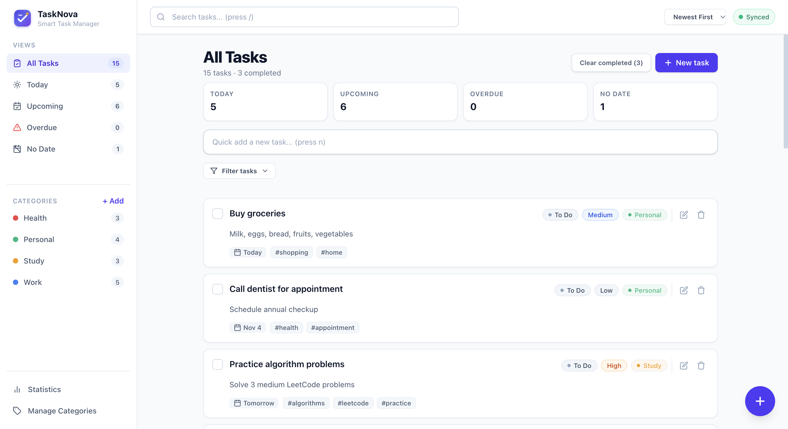
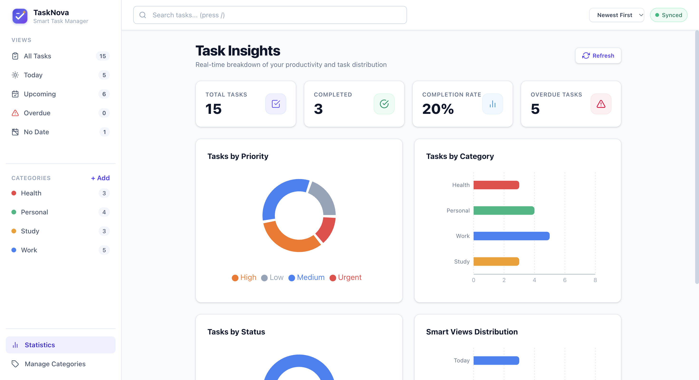

# TaskNova - Smart To-Do & Task Manager

A full-stack MERN application for managing tasks with categories, priorities, smart groups, statistics, and offline support.

## 📸 Screenshots

### 1. Dashboard


### 2. Task Insights Page

## Features

### 1. Task Management (CRUD)
- Create, read, update, and delete tasks
- Fields: title (required, max 120 chars), description (max 1000 chars), category, priority (low/medium/high/urgent), status (todo/in-progress/done), due date, tags (max 10, 20 chars each)
- Optimistic UI updates for instant feedback
- Idempotent creation with `clientId` to prevent duplicates on retry

### 2. Categories
- Full CRUD for categories with name (unique, max 40 chars) and color (hex)
- Categories can be assigned to tasks
- Deleting a category unassigns it from tasks
- Task count displayed per category

### 3. Search & Filters with URL Sync
- **Text search** (q): searches title and description
- **Category filter**: single select, includes "Uncategorized"
- **Priority filter**: multi-select checkboxes
- **Status filter**: multi-select checkboxes
- **Tag filter**: exact match
- **Due date range**: from/to date pickers
- **Overdue only**: checkbox
- **Smart groups**: Today, Upcoming (7 days), Overdue, No date
- **Sort options**: Newest First, Oldest First, Due Date, Priority
- All filters sync to URL query string for shareable/bookmarkable views

### 4. Local Persistence & Offline Queue
- localStorage cache for tasks and categories (instant load on refresh)
- Offline queue with FIFO replay when connection restores
- Online/offline detection with sync status indicator
- Background sync every 30 seconds when online
- Operations queued: create/update/delete tasks, create/update/delete categories, toggle status

### 5. Smart Groups (Server-side)
- **Today**: tasks due today
- **Upcoming**: tasks due in the next 7 days
- **Overdue**: past due tasks not marked done
- **No date**: tasks without a due date

### 6. Statistics Dashboard with Recharts
- Summary cards: Total, Completed, Completion Rate, Overdue
- Pie chart: Tasks by Priority
- Horizontal bar chart: Tasks by Category
- Pie chart: Tasks by Status
- Horizontal bar chart: Smart Groups distribution
- Real-time refresh button

### 7. Dark Mode
- Tailwind CSS dark mode with `class` strategy
- Persisted in localStorage
- System preference detection on first load
- Toggle in header with emoji icons (🌙/☀️)

### 8. Keyboard Shortcuts
- `/` — Focus search input (when not in input/textarea/select)
- `n` — Open Quick Add task form

### 9. Responsive Layout
- **Desktop (≥768px)**: Persistent left sidebar with navigation, smart groups, categories
- **Mobile (<768px)**: Collapsible sidebar with hamburger menu, top header with search, theme toggle, sync status
- Breakpoints: sm (640px), md (768px), lg (1024px)

## Tech Stack

- **Backend**: Node.js 18+, Express, MongoDB (Mongoose)
- **Frontend**: React 18, Vite, React Router v6
- **Styling**: Tailwind CSS v4
- **Charts**: Recharts
- **Date handling**: date-fns
- **HTTP client**: Axios
- **Validation**: express-validator

## Project Structure

```
├── client/                 # React frontend
│   ├── src/
│   │   ├── api/           # Axios API clients
│   │   ├── components/    # Reusable UI components
│   │   │   ├── common/    # Modal, ConfirmDialog, Spinner, Toast, etc.
│   │   │   ├── filters/   # FilterBar, FilterChips, SortSelect
│   │   │   ├── layout/    # Layout, Sidebar, Header
│   │   │   ├── stats/     # StatsPanel
│   │   │   └── tasks/     # TaskForm, TaskList, TaskCard, QuickAdd
│   │   ├── context/       # TaskContext (global state)
│   │   ├── hooks/         # Custom hooks (useFilters, useTheme, useDebounce)
│   │   ├── pages/         # Dashboard, Stats, Categories
│   │   ├── storage/       # localStorage cache & sync queue
│   │   ├── utils/         # Filters, dates, constants, helpers
│   │   ├── App.jsx
│   │   ├── main.jsx
│   │   └── index.css
│   └── package.json
├── server/                 # Express backend
│   ├── src/
│   │   ├── config/        # MongoDB connection
│   │   ├── controllers/   # Task, Category, Stats controllers
│   │   ├── middleware/    # Validation, error handling, notFound
│   │   ├── models/        # Task, Category Mongoose models
│   │   ├── routes/        # Express routes
│   │   ├── utils/         # Query builder
│   │   ├── app.js
│   │   ├── server.js
│   │   └── seed.js
│   └── package.json
└── README.md
```

## Getting Started (macOS, No Docker)

> **No Docker required**: TaskNova runs completely natively on macOS. MongoDB runs locally at `mongodb://127.0.0.1:27017/smart-todo`. The backend runs on port **5001** (macOS AirPlay occupies port 5000) and the Vite client runs on port **5173** with proxying to `/api`.

### Prerequisites

```bash
# Ensure Node 18+ and MongoDB Community are installed via Homebrew
brew install node
brew tap mongodb/brew
brew install mongodb-community
brew services start mongodb-community

# Verify MongoDB is running
mongosh --eval "db.runCommand({ ping: 1 })"
```

### Installation

```bash
# Install root, server, and client dependencies in one command
npm run install:all
```

### Seeding the Database

```bash
# Seed 4 categories and 15 sample tasks into local MongoDB
npm run seed
```

### Running Locally

```bash
# Start both server (port 5001) and client (port 5173) concurrently:
npm run dev

# Or run separately in two terminal windows:
# Terminal 1: Backend API (port 5001)
npm run dev:server
# Terminal 2: Frontend Vite App (port 5173)
npm run dev:client
```

Open your browser to:
- Frontend: **http://localhost:5173**
- Backend Health: **http://localhost:5001/api/health**

### Production Build

```bash
# Build the client for production
npm run build

# Start the server
npm run start
```

## API Endpoints

### Tasks
| Method | Endpoint | Description |
|--------|----------|-------------|
| GET | `/api/tasks` | List tasks with filters, pagination, sorting |
| POST | `/api/tasks` | Create task |
| GET | `/api/tasks/:id` | Get task by ID |
| PUT | `/api/tasks/:id` | Update task |
| PATCH | `/api/tasks/:id/status` | Update task status |
| DELETE | `/api/tasks/:id` | Delete task |
| DELETE | `/api/tasks?status=done` | Bulk clear done tasks |

### Categories
| Method | Endpoint | Description |
|--------|----------|-------------|
| GET | `/api/categories` | List categories with task counts |
| POST | `/api/categories` | Create category |
| PUT | `/api/categories/:id` | Update category |
| DELETE | `/api/categories/:id` | Delete category |

### Stats
| Method | Endpoint | Description |
|--------|----------|-------------|
| GET | `/api/stats` | Get aggregated statistics |

### Health
| Method | Endpoint | Description |
|--------|----------|-------------|
| GET | `/api/health` | Health check |

### Query Parameters (Tasks)
| Param | Type | Description |
|-------|------|-------------|
| q | string | Search in title/description |
| category | string | Category ID or "none" |
| priority | string | Comma-separated priorities |
| status | string | Comma-separated statuses |
| tag | string | Exact tag match |
| dueFrom | date | Due date >= (ISO 8601) |
| dueTo | date | Due date <= (ISO 8601) |
| overdue | boolean | "true" for overdue only |
| group | string | today/upcoming/overdue/nodate/all |
| sort | string | -createdAt/createdAt/dueDate/-priority |
| page | number | Page number (default 1) |
| limit | number | Items per page (default 20, max 100) |

## Environment Variables

### Server (.env)
```env
PORT=5001
MONGODB_URI=mongodb://localhost:27017/tasknova
CLIENT_ORIGIN=http://localhost:5173
```

### Client (.env)
```env
VITE_API_URL=http://localhost:5001/api
```

## NPM Scripts

### Server
| Script | Description |
|--------|-------------|
| `npm run dev` | Start with nodemon |
| `npm start` | Start production server |
| `npm run seed` | Seed database with sample data |

### Client
| Script | Description |
|--------|-------------|
| `npm run dev` | Start Vite dev server |
| `npm run build` | Production build |
| `npm run preview` | Preview production build |

## Offline Support

The application works offline by:
1. Caching tasks and categories in localStorage on every successful API response
2. Loading from cache instantly on app start
3. Queueing mutations (create/update/delete) when offline
4. Replaying queued operations FIFO when connection restores
5. Showing sync status in header (Synced / Offline (N pending) / Syncing...)

## Keyboard Shortcuts

| Key | Action |
|-----|--------|
| `/` | Focus search input |
| `n` | Open Quick Add task form |
| `Escape` | Close modals/forms |

## Browser Support

- Chrome/Edge 90+
- Firefox 88+
- Safari 14+
- Requires localStorage, fetch, ES2020 features

## License

MIT
